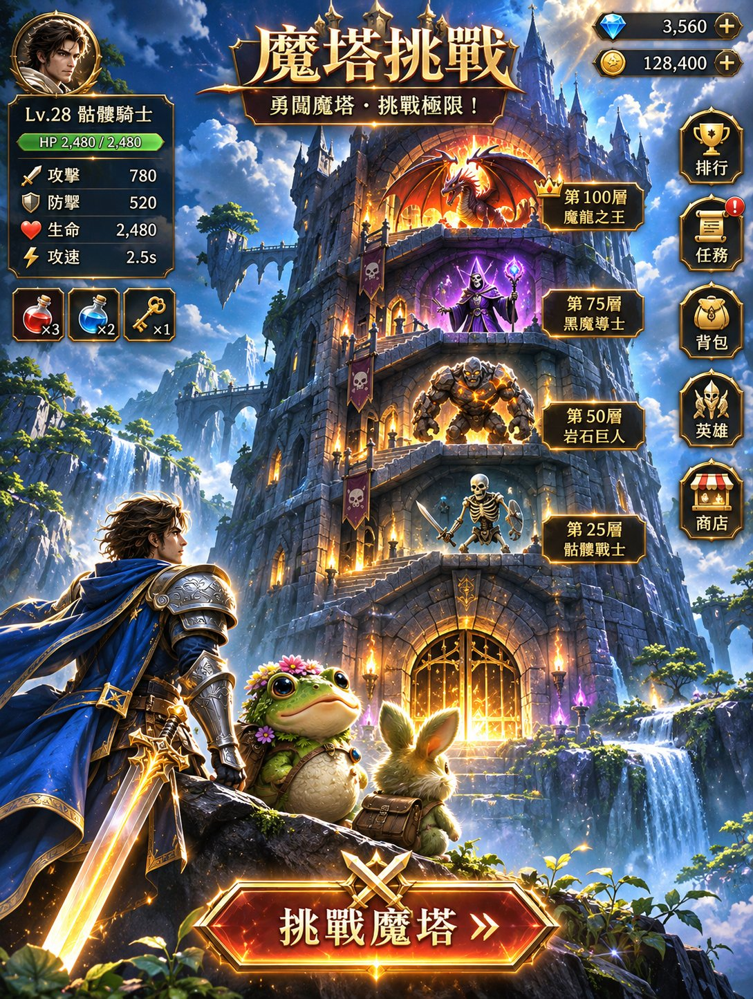

# 27. The attack moment and the tower run (2026-11-28)

中文：[zh_TW/27_ATTACK_MOMENT_AND_TOWER_RUN.md](zh_TW/27_ATTACK_MOMENT_AND_TOWER_RUN.md).

The owner's notes of 2026-11-28 (written in Chinese; the original is in the zh_TW copy, §0) cover two things:

- **Part A, the attack moment:** every monster attack becomes a short scene: the camera comes close, the player reads
  the monster's move and answers it (guard, dodge, tap, draw...), then the result. It is like a boss's special today,
  but short, and for every attack.
- **Part B, the tower run:** the player goes out of the tower after a death or a clear, with a score. The story is split
  into chapters, and challenge chapters come between them. The money (stamina, gold, crystals) should make the player
  go out and grow (forge, card fusion). Before a boss, the rounds have 1, 2, then 4 monsters.

**Built on 2026-11-28** (§8: what, and where to change it). The owner answered §5 and §7 ("all use yours").

## 0. The owner's notes (in short)

1. Make the gap between monster attacks longer. At each attack the camera is forced in on the monster.
2. Then comes the monster's attack animation with a command to tap, to lower the damage or to dodge it. The zoom takes
   about 0.3 s, then the monster attacks at once. The player taps guard (bottom right), or within the attack animation's
   0.5 s a dodge appears toward a direction, or cells as in today's boss fights.
3. An attack that cannot be dodged shows a "can't dodge" sign: only guard works.
4. The timing: the zoom 0.3 s; a normal attack's dodge command with the monster's animation 0.5 s; the hero's dodge
   failing (hit) or his guard animation 0.5 s; about 1 to 1.3 s in all, shorter when the dodge succeeds.
5. Each monster times its attacks and its dodge commands its own way: a small monster may be a rhythm (one tap); a
   stronger one may need several taps, a drawn shape, or moving again and again to dodge the magic it sprays.
6. A skill attack's time grows with the monster's animation.
7. A monster's attack has a fixed wind-up that shows what comes next: an attack coming from right to left means swipe
   right to dodge. Not every monster warns first, so its attack animation must show it. A small monster has one fixed
   animation, so its dodge is fixed. A stronger one has several attacks from different directions, played at random,
   and the player reads the animation to pick the dodge.
8. While the camera is close on the monster the player cannot attack. A player who wants a combo times it himself.
9. Think about it: how idle stamina, and the gold and crystals from beating monsters, can pace the game, so the player has
   to leave the tower to upgrade gear outside, or to fuse collectible cards.
   1. Dying in the tower or clearing it sends the player out, with a score tally.
   2. So the story is split into chapters: not 30 floors at once.
   3. A chapter without story is a challenge stage of about 5 to 10 floors.
10. The monsters before a boss: the first round one monster, the second two, the third four; then the boss, which casts
    its magic straight after its introduction.

## 1. Where the game is now

| Area | Today | Where |
|---|---|---|
| A monster's attack | Each has its own clock (`atk_interval_ms`: the slime 1 s, Hivebear 2.6 s). A warning (`guard` `"warnMs"` 500), then it lands; the guard button (bottom right) blocks 70 %, a perfect guard parries | battle.json `guard`, docs 13 §9.2, 15 §3.2 |
| The player during it | Can keep attacking; a combo can run through the monster's attack (`combo_runs_through_attacks`) | battle.json |
| A boss's special | Danger cells light (`cells`), the player taps out of them; the camera close only at the attack's introduction, and the player cannot attack then (11-27) | docs 21, 22 §4, 25 |
| Monster art | Most monsters are one picture; a rig (`FoeRig`) plays "die"; few attack clips | docs 18, 20 |
| Dodging | Only the boss cells; no dodge for a normal attack | |
| The tower | Death: back to the floor's start with half HP; the run goes on (rebirth is the story's cycle) | game_combat.cpp `f_FinishCombatLose` |
| Story | 7 chapters, about 5 floors each (F01–F35), all built; the floor table still lists 70 floors in 10 acts | doc 23 §4, floor_table |
| Boss fights | A sequence: 3 guards, one at a time, then the boss | doc 25 |
| Money and growth | Gold, crystals (crystal events), cards (each monster's), forge, skills, the village hub, the store | card_collection, forge_system, hub_system |

## 2. Part A: the attack moment

### 2.1 The beat

Every monster attack (not only a boss's special) plays this beat. The numbers are the owner's; they go in `battle.json`
`"attackMoment"` so they can be tuned.

| Time | What happens | Data |
|---|---|---|
| 0 | **The camera comes in** on the monster (0.3 s); the player's input for attacks stops (§2.2) | `zoomMs` 300, `zoom` |
| 0.3 s | **The monster attacks:** its attack animation and, at the same time, **the answer** the player must give (§2.3) | `answerMs` 500 |
| 0.8 s | **The result:** dodged (the hero steps aside: short), guarded (guard animation), or hit (hurt animation) | `resultMs` 500, `dodgeResultMs` 250 |
| ~1.05–1.3 s | The camera goes back; the player can attack again | `backMs` |

**A skill attack** (a monster's move with its own animation) is longer: its answer time runs as long as its animation
(owner, point 6). A boss's special keeps its own rundown (CLAUDE.md "special attacks").

**The gap between attacks is longer** (owner, point 1): each monster's `atk_interval_ms` stays, times a new
`"attackGapScale"` in battle.json (proposed 2.0, Q127), so the player has room to attack between the beats.

### 2.2 No attacks during the beat

While the camera is in, the player's attack input is ignored and the play is not drawn (as in a boss's special intro
today). **A combo or a play already running when the beat starts** is cut off: the hits so far count, the rest are lost
(Q128). This is the owner's point: a player who wants a full combo times it between the monster's attacks. A long bow
draw is cancelled as today (`TouchPlay::f_CancelHold`).

### 2.3 The answers

Each attack says which answers it takes. The guard button is always there unless the attack cannot be guarded.

| Answer | What the player does | For | Reuses |
|---|---|---|---|
| **guard** | taps the guard button (bottom right) in the window; a perfect one parries | every attack unless `"noGuard"` | today's guard |
| **dodge** | one swipe the way the attack says (an attack from right to left: swipe right, as the owner wrote; Q129) | normal attacks | swipe judging (`swipeWay`) |
| **tap** | one tap on the beat (a ring closes on the monster) | small monsters: "a rhythm" | `sequenceClick` timing |
| **taps** | several taps in the window (N) | stronger monsters | `mash` |
| **shape** | draws a shape (a circle, a V...) in the window | stronger monsters | `drawShape`, the gestures |
| **move** | dodges again and again: the magic sprays come in waves, swipe left or right each time | casters | the cells (as a boss's), shorter |
| **cells** | today's boss cells | bosses | `cells` |

- **Can't dodge** (owner, point 3): the attack shows a "can't dodge" sign (無法閃避) and only guard works.
- **Can't guard** (proposal, Q130): the other way round: a "can't guard" sign (無法防禦), only the dodge works.
- **No answer, or the wrong one:** the hit lands in full (as a missed guard today).
- **Dodged:** no damage, a "Dodge!" word (text `battle.word_dodge` already exists), the hero's quick side step.

### 2.4 Reading the attack

- **A wind-up that tells** (owner, point 7): some attacks show their direction first (an arrow, a glow on the side it
  comes from). `"tell": true`.
- **Without a tell** the attack animation itself is the hint: the player sees where it comes from and answers.
- **A small monster** has one attack animation, so its answer is always the same (easy, learnt once).
- **A stronger monster** has several attacks from different directions, picked at random (each with a `"chance"`, as
  the boss moves have), and the player reads which one it is.

### 2.5 The data (a sketch)

```json
// enemies.json, a monster
"attacks": [
  { "id": "swipe_rl", "anim": "lunge_left", "answer": "dodge", "dodge": "right", "tell": false, "chance": 50 },
  { "id": "slam",     "anim": "slam",       "answer": "guard", "noDodge": true,                  "chance": 30 },
  { "id": "spray",    "anim": "cast",       "answer": "move",  "waves": 3, "skill": true,          "chance": 20 }
]
// battle.json
"attackMoment": { "zoomMs": 300, "zoom": 1.2, "answerMs": 500, "resultMs": 500, "dodgeResultMs": 250, "backMs": 200 },
"attackGapScale": 2.0
```

A monster without `"attacks"` gets one: `{ "anim": "lunge", "answer": "guard" }` (today's play with the new camera).
The answers are the blocks the weapons already use (docs 16, 17 "reusable blocks"), not new code each.

### 2.6 The art

Directional attack animations are the big cost: most monsters are one picture. Proposal (Q131): first, **motion poses
made in code** from the monster's picture: `lunge_left` / `lunge_right` (it slides and leans across), `slam` (it rises
and drops), `sweep` (it turns), `cast` (it glows and shakes), each readable by its direction. Real clips (the animation
editor, doc 18) replace them monster by monster, by the same names.

## 3. Part B: the tower run

### 3.1 Going out: death or a clear

- **A climb** is one entry into the tower, for one chapter (§3.2).
- **It ends** when the hero dies or clears the chapter's last floor (its boss). Either way he is **sent out** to the
  village (owner, point 9.1). Today a death only sends him back to the floor's start.
- **The tally:** a score screen: floors cleared, monsters beaten, best combo, perfect guards and dodges, damage taken,
  time; a rank (S, A, B, C) and a bonus by the rank (Q139).
- **What he keeps** (proposal, Q134): EXP, levels, items and cards always. Gold and crystals found in this climb: all on
  a clear (plus the rank bonus), half on a death. So pushing on is a risk, and going out is a choice.

### 3.2 Chapters

- **The story in chapters** (owner, point 9.2): doc 23's 7 chapters (about 5 floors each) are each a climb, chosen at the
  tower's gate in the village. A climb starts at the chapter's first floor (Q135).
- **Challenge chapters** (owner, point 9.3): 5 to 10 floors with no story, harder, replayable; they pay crystals and
  card chances. One opens after each story chapter (Q140), made from that chapter's looks and monsters (Q136).
- The 70-floor table (10 acts) becomes the chapters' list.

### 3.3 Before a boss: rounds of 1, 2, 4

(owner, point 10; changes doc 25's three single guards)

| Round | Fight |
|---|---|
| 1 | one monster |
| 2 | two monsters together (a party fight) |
| 3 | four monsters together |
| boss | its introduction, then **at once its magic**: its special is its first move (Q133) |

The ladder (doc 25 §3) shows the rounds; the travel between them stays. HP is kept between the rounds (as Q123).

### 3.4 The money: why go out

The owner asked to think this through. The proposal:

- **Stamina for the tower (掛機體力?, Q137):** a climb costs stamina (a story chapter 10, a challenge 15); it fills up
  with real time, also while the game is closed (1 every 5 min, up to 60). It stops endless climbing and gives the
  village time.
- **Gold and crystals are spent outside** (Q138): no shop in the tower. Outside:
  - **the forge**: upgrade a weapon or armour (gold + crystals; the cost grows with each level);
  - **card fusion**: three of the same monster card + crystals make a higher card (a stronger bonus); cards come from
    monsters (`card_collection`), so a chapter is replayed for the cards it has;
  - **the weapon master**: weapon training (weapon EXP for gold);
  - **the store**: potions and gear for the next climb.
- **The pacing:** each story chapter asks for a gear level about one or two challenge climbs above the last one, so the
  loop is: climb, go out, grow, climb again. The numbers are tuned in data.

### 3.5 Stamina as decided (the owner, 2026-11-28)

- **Every fight costs 1 stamina** (體力); **+1 every 5 minutes**.
- **A file keeps it:** the stamina now and the time of the next recovery (a real clock time, so it also fills while the
  game is closed: on start, the time passed since then adds its points).
- **A timer** adds 1 when the time comes, then starts the next one; **when it is full there is no timer**. When a point
  is spent from full, the timer starts.
- The maximum and what happens at 0 are Q144.

## 6. The main screen (the owner, 2026-11-28)

A new phase: **the main screen** (主畫面), after the title. From it the player **picks a story, then a chapter** in it,
then climbs. The tutorial is in chapter 1. Five chapters for now (Q141).

The owner's picture (a reference for the layout and the feel, not art to ship):



| Part (in the picture) | What it is | Proposal |
|---|---|---|
| The tower in the middle, its floors marked with their bosses (25, 50, 75, 100) | the chapters and their bosses | each chapter a band on the tower with its boss; cleared ones lit, the next one glowing, later ones dark |
| Top left: the hero's face, level, HP, attack, defence, life, attack speed | the hero's state | from Player (its level, stats) |
| Under it: potions, keys | quick items | from the items held |
| Top right: 💎 and gold, each with + | money | gold; 💎 = crystals? (Q145); stamina shown here too, with its next-point time |
| Right side: ranking, quests (a red dot), bag, heroes, shop | other screens | Q146 |
| Bottom: 挑戰魔塔 (challenge the tower) | start | opens the story list, then the chapter list (Q142) |
| The hero, the toad and the rabbit in front | the party, for the feel | the hero's art; the companions later |

**Art:** our own painting of the tower made for the game (ComfyUI, the game's style), the buttons as RmlUi; the
reference picture itself is not used in the game.

## 7. New questions (2026-11-28)

| Question | Default | Yours | Answer |
|---|---|---|---|
| **Q141** "Five chapters for now": doc 23 has 7 chapters (F01–F35), all built. Merge them into 5, or show the 7? | the 7 as built | keep the 7; each locked until the one before is cleared | Yours (the owner, 11-28) |
| **Q142** "Pick a story, then a chapter": today there is one story (the orphan). What else is in the story list? | the one story | the story, plus a "Challenge" entry whose chapters are the challenge chapters (Q140) | Yours (the owner, 11-28) |
| **Q143** A death: half of the gold found in this climb, or of all the gold held? Crystals too? "Continue" means the chapter's first stage again with full HP? | — | half of the gold and crystals found in this climb; continue = the chapter's first stage, full HP | Yours (the owner, 11-28) |
| **Q144** Stamina: its maximum? At 0? Does a party fight (2 or 4 monsters) cost 1? A lost fight? | — | max 60; at 0 no fight starts: "Not enough stamina, next point in m:ss", back to the main screen or wait; a fight costs 1 whatever its size, spent when it starts | Yours (the owner, 11-28) |
| **Q145** The picture's 💎: the crystals, or a new money? | — | the crystals | Yours (the owner, 11-28) |
| **Q146** The right-side buttons: which work now? | — | bag (the player menu), shop (the store), quests (the quest board) now; ranking and heroes shown dimmed, later | Yours (the owner, 11-28) |
| **Q147** The village (hub, weapon master, forge, card fusion): still reached from the main screen? | — | yes: a "Village" button on the main screen | Yours (the owner, 11-28) |

## 4. Order of work (proposed)

| Step | What | Needs |
|---|---|---|
| A1 | The beat for every monster: the camera in, no attacks, guard, the result; `attackGapScale` | Q127, Q128 |
| A2 | Dodge by swipe; "can't dodge" / "can't guard"; the motion poses in code | Q129–Q131 |
| A3 | The answers per monster (tap, taps, shape, move); random attacks from `"attacks"` | A2 |
| B1 | Boss rounds 1, 2, 4; the boss's special first | Q132, Q133 |
| B2 | A climb per chapter: out on death or clear, the tally, what is kept | Q134, Q135, Q139 |
| B3 | Stamina; spending only outside; card fusion; forge costs | Q137, Q138 |
| B4 | Challenge chapters | Q136, Q140 |

Part A and B1 are about the fight, and can start first; B2–B4 change the whole game's flow.

## 5. Questions for the owner

| Question | Default | Yours | Answer |
|---|---|---|---|
| **Q127** How much longer the gap between monster attacks? | as now (the slime 1 s, Hivebear 2.6 s) | ×2 for every monster (`attackGapScale` 2.0), each still tunable | Yours (the owner, 11-28) |
| **Q128** A combo or play running when the beat starts | goes on (as now) | cut off: the hits so far count | Yours (the owner, 11-28) |
| **Q129** The dodge's direction: an attack from right to left means swipe right (as written), or swipe away from it? | (no dodge today) | as written; each attack's `"dodge"` in data, so either works | Yours (the owner, 11-28) |
| **Q130** Besides "can't dodge" (guard only), a "can't guard" (dodge only)? | only "can't dodge" | both | Yours (the owner, 11-28) |
| **Q131** The attack animations: motion poses made in code from the picture first, real clips later? | no new animation | yes, poses in code first | Yours (the owner, 11-28) |
| **Q132** Before a boss: rounds of 1, 2, 4 monsters instead of doc 25's three single guards? From the floor's monsters? | three single guards | yes, from the floor's monsters (or the boss's own list) | Yours (the owner, 11-28) |
| **Q133** "The boss casts at once after its introduction": its special as its first move? | its moves by chance | yes: its first move is its special (MP starts at its cost) | Yours (the owner, 11-28) |
| **Q134** What is kept after a climb? | death: back to the floor's start | EXP, items, cards always; gold and crystals: all on a clear (+ rank bonus), half on a death | Died: half the gold, then a choice: continue, or back to the main screen (the owner, 11-28; details Q143) |
| **Q135** Each climb starts at the chapter's first floor? | (one long run) | yes; a cleared chapter can be climbed again | Yes: continue from the current chapter's first stage (the owner, 11-28) |
| **Q136** Challenge chapters: fixed floors or new random ones each time? | — | fixed first (the chapter's floors with harder monsters), random later | Yours (the owner, 11-28) |
| **Q137** What is "掛機體力" (idle stamina): tower stamina that fills with real time even when closed; rewards while away; or the battle's stamina? | — | tower stamina: a climb costs 10 (challenge 15), +1 every 5 min, up to 60 | Every fight costs 1; +1 every 5 min; saved to a file (stamina now, next recovery time); a timer only while not full (the owner, 11-28; §3.5) |
| **Q138** Gold and crystals spent only outside (forge, card fusion, weapon master, store), no shop inside? | the store and events as now | yes | Yours (the owner, 11-28) |
| **Q139** The score: what counts, and what the rank gives? | — | floors, monsters, best combo, perfect guards/dodges, damage taken, time; rank S–C gives crystals | Yours (the owner, 11-28) |
| **Q140** Where the challenge chapters go | — | one opens after each story chapter | Yours (the owner, 11-28) |

## 8. As built (2026-11-28)

The owner's answers (§5, §7: "all use yours") are built, all of §4's steps. Where to change each thing:

| What | Built | Where to change it |
|---|---|---|
| **The attack beat** (§2.1–2.2) | every monster attack except a special (cells), a guard move, a volley's next hit and the tutorial's lessons: the camera in (0.3 s), the monster's pose and the answer (0.5 s), the hit or dodge, the result (0.5 s; a dodge 0.25 s); everything else waits; a play running is cut off (its hits count), a held pull let go | `battle.json` `"attackMoment"` (`zoomMs`, `zoom`, `answerMs`, `shapeMs`, `tapsMs`, `waveMs`, `resultMs`, `dodgeResultMs`, `backMs`, `swipeMin`, `tapWindowMs`, `stepPx`, `default`, `off`); code: `game_moment.cpp` |
| **The gap between attacks** (Q127) | every monster's, times 2 (its specials keep theirs) | `battle.json` `"attackGapScale"` |
| **The answers** (§2.3) | guard (a press in the window; in its last `parryMs` a parry), dodge (a swipe its way), tap (as the ring closes), taps (N), shape (a gesture), move (a swipe a wave; each wave not dodged its share of the damage); "can't dodge" and "can't guard" signs | each monster's `enemies.json` `"attacks"`: `answer`, `dodge`, `pose`, `tell`, `noDodge`, `noGuard`, `need`, `shape`, `waves`, `answerMs`, `chance` |
| **Each monster's attacks** (§2.4) | 96 monsters: a small one (body 1) one fixed attack (a tap, or a lunge with its way shown); body 2–3 several at random with no way shown (lunge → swipe right, low sweep → up, high swing → down, slam → guard only), casters magic waves, body 3 also taps and a circle; bosses all of them, a slam that can't be dodged and a high swing that can't be guarded | `python tools/make_monster_attacks.py` writes them (re-run after changing its rules), or edit a monster's line by hand |
| **The poses** (§2.6, Q131) | made in code from the monster's picture (2D and the 3D stage): lunge, slam, sweep_low, sweep_high, cast | `Game::f_MomentPose` (game_moment.cpp) |
| **Boss rounds** (§3.3, Q132) | 1, then 2 together, then 4 together (the floor's monster kinds in turn), then the boss; a fight now holds up to 4 (`g_iMaxFoes`), 4 in a row on the screen, closer on the 3D stage | `battle.json` `"gauntlet"` `"rounds"`; `"stages3d"` marks `spacingMany`, `shiftMany`; battle.rcss `.foe.n4` |
| **The boss's opener** (Q133) | its first move is its first special, paid for, its cells lighting as its introduction ends | `battle.json` `"bossOpensWithSpecial"`, `"openerMs"` |
| **The main screen** (§6) | after the title (New Game and Continue): the tower painting, the story's chapters as bands (cleared, ready, locked), the hero, crystals, gold, stamina and its next point, the buttons (ranking and heroes dimmed: "coming soon"), "challenge the tower" → the stories → a story's chapters → the climb; the village's open places | `ui/main.rml`, `ui/main.rcss`; the painting `ui/main/tower_bg.png` (`python tools/art/make_main_tower.py --paint 11,22 / --use 22`, ComfyUI) ; code: `game_tower.cpp` |
| **Stories and chapters** (Q141, Q142, Q140, Q136) | the orphan's 7 chapters (each opens when the one before is cleared) and the Challenge Towers I–VII (each on a story chapter's floors, opened when it is cleared, monsters ×1.5–1.8 HP, ×1.3–1.5 ATK, more gold, crystals when cleared) | `data/tower_run.json` `"stories"` |
| **A climb** (§3.1, Q134, Q135, Q143) | starts on the chapter's first floor with full HP; the stairs never leave the chapter; up from its last floor clears it; a death: half of the climb's gold and crystals lost, the tally, then continue (the first floor again) or the main screen; no shop and no floor select in a climb | `data/tower_run.json` `"death"` |
| **The tally** (Q139) | floors, monsters, best combo, perfect dodges and parries, damage taken, time; the score, the rank (S 30, A 20, B 10, C 5 crystals on a clear) | `data/tower_run.json` `"score"`, `"ranks"` |
| **Stamina** (Q137, Q144) | each map fight in a climb costs 1; +1 every 5 minutes of real time, also while closed; the file `stamina.json` in the save folder (`stamina`, `nextAt`); a timer only while not full; at 0 the fight does not start: "next point in m:ss", wait or the main screen (going home this way keeps everything) | `data/tower_run.json` `"stamina"` (`max` 60, `everySec` 300, `perFight` 1) |

**Tests:** scenarios `battle_moment_dodge`, `battle_moment_guard_only`, `battle_four_monsters`, `boss_opens_special`,
`boss_gauntlet_start` and `_next` (updated for the rounds), `main_screen`, `main_pick_chapter`, `climb_died`, `climb_cleared`;
`unit.tower_run_test` (the stamina clock, the file, the rules, the score).

**Not done:** the tutorial's own fight keeps its old guard (its lessons are timed for it); the store's "+" buttons on the
crystals and gold, ranking and heroes are not built; card fusion (§3.4) is not built yet.
