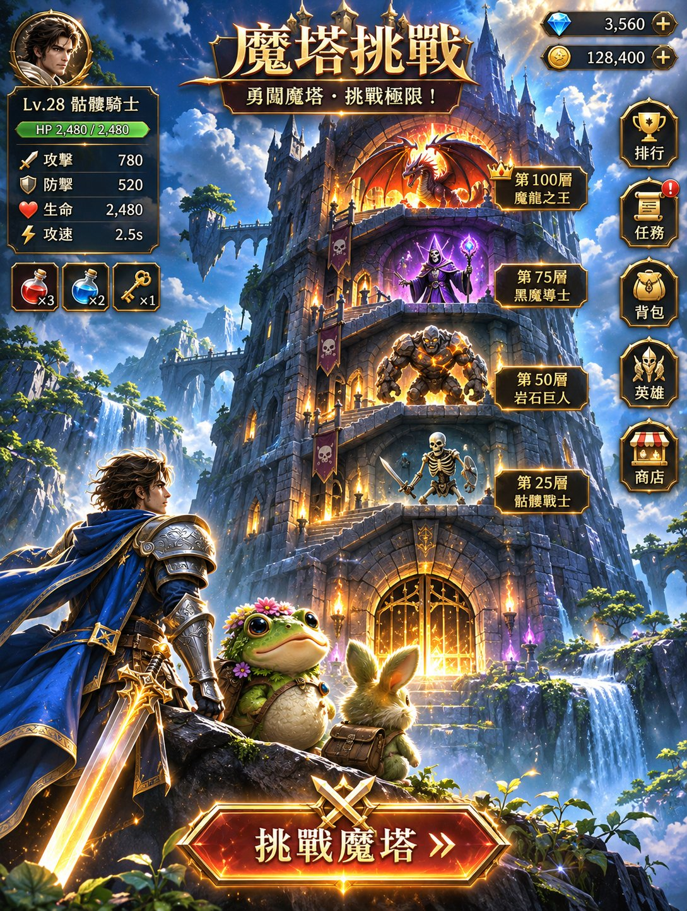

> 英文原文：[27_ATTACK_MOMENT_AND_TOWER_RUN.md](../27_ATTACK_MOMENT_AND_TOWER_RUN.md)

# 27. 攻擊時刻與魔塔的一趟攀登（2026-11-28）

擁有者 2026-11-28 的筆記（§0 原文）包含兩件事：

- **A 部分，攻擊時刻：**怪物的每一次攻擊都變成一小段場景：鏡頭拉近，玩家看懂怪物的動作並回應（防禦、閃避、點擊、畫形狀……），
  然後是結果。像現在 boss 的特殊攻擊，但很短，而且每次攻擊都有。
- **B 部分，一趟攀登：**死亡或通關後玩家離開魔塔並結算分數。故事分章，章與章之間有挑戰關卡。錢（體力、金幣、水晶）要讓玩家出去
  成長（鍛造、卡片合成）。boss 前的小關分別是 1、2、4 隻怪。

**2026-11-28 已完成**（第 8 節：做了什麼、在哪裡改）。擁有者回答了第 5、7 節（「都用你的」）。

## 0. 擁有者的筆記（原文）

> 敵人攻擊間隔時長拉長，強迫拉進鏡頭，會出現敵人攻擊動畫搭配點指定指令場降低或閃避敵人攻擊，拉近約0.3秒然後敵人立刻出招看要點右下的防禦或是敵人攻擊的動畫0.5秒內會出現往某個方向的閃避，或是像現在boss戰的點格子
> 不能閃避的招會出現無法閃避的提示，只能點防禦
> 敵人攻擊時鏡頭拉近03秒，普通攻擊時出現閃躲指令加敵人攻擊動畫0.5秒，角色躲避失敗被攻擊或是防禦動畫0.5秒，整體約在1-1.3秒，玩家躲避成功時秒數較短，不同敵人攻擊的時機點跟閃躲指令會不同，普通小敵人可能是抓節奏，點一下就好，較強的敵人可能要連點或是畫形狀，或是要連續位移躲避噴出來的魔法
>
> 技能攻擊時秒射會依照敵人的動畫延長
>
> 敵人攻擊時會有固定的起手式提示接下來要做什麼事，出現一個由右往左的攻擊時就是要往右滑閃躲，但是不是每個敵人都會預先給閃躲提示，這邊要補上敵人攻擊動畫，如果小怪只需要一種固定動畫，所以躲避指令也是固定的，比較強的怪物會有較多不同攻擊方向的動畫，隨機播放這時候就要看動畫預判躲避的方向來做對應的指令閃躲
>
> 玩家在敵人鏡頭拉近時就不能做攻擊指令（所以玩家想要用連招要自己抓準時機）
>
> 想一下，掛機體力以及打倒敵人的金幣水晶怎麼拖枱錢讓玩家要離開魔塔出去到外面做一些升級裝備或是有收集要素的卡片合成，
> 1.魔塔中死或通關了就會被傳送出去，會統計得分通過
> 2.這樣故事線就要拉出來分章，不要一次30層，要分章別
> 3.沒有故事的章節是挑戰關卡，約5-10層
> Boss關卡前的小怪，第一小關一隻怪，第二小關兩隻，第三小關四隻，然後打boss一進去intro完直接噴魔法

## 1. 遊戲現在的樣子

| 部分 | 現在 | 位置 |
|---|---|---|
| 怪物攻擊 | 各自的計時（`atk_interval_ms`：史萊姆 1 秒、蜂巢熊 2.6 秒）。先警告（`guard` 的 `"warnMs"` 500），然後命中；右下的防禦鈕擋 70 %，完美防禦是格擋 | battle.json `guard`，文件 13 §9.2、15 §3.2 |
| 那時的玩家 | 可以繼續攻擊；連擊可以穿過怪物的攻擊（`combo_runs_through_attacks`） | battle.json |
| boss 的特殊攻擊 | 危險格子亮起（`cells`），玩家點離開；只有攻擊開場時鏡頭拉近，那時玩家不能攻擊（11-27） | 文件 21、22 §4、25 |
| 怪物的圖 | 大多是一張圖；骨架（`FoeRig`）播放「die」；攻擊動畫很少 | 文件 18、20 |
| 閃避 | 只有 boss 的格子；普通攻擊沒有閃避 | |
| 魔塔 | 死亡：回到該層起點，HP 一半；這一輪繼續（輪迴是故事的循環） | game_combat.cpp `f_FinishCombatLose` |
| 故事 | 7 章，每章約 5 層（F01–F35），都已做好；樓層表仍列出 70 層、10 幕 | 文件 23 §4、floor_table |
| boss 戰 | 連戰：3 隻守衛一隻一隻打，然後 boss | 文件 25 |
| 錢與成長 | 金幣、水晶（水晶事件）、卡片（每種怪物）、鍛造、技能、村莊、商店 | card_collection、forge_system、hub_system |

## 2. A 部分：攻擊時刻

### 2.1 節拍

怪物的每一次攻擊（不只 boss 的特殊攻擊）都播放這個節拍。數字是擁有者的；放在 `battle.json` 的 `"attackMoment"`，可以調整。

| 時間 | 發生什麼 | 資料 |
|---|---|---|
| 0 | **鏡頭拉近**怪物（0.3 秒）；玩家的攻擊輸入停止（§2.2） | `zoomMs` 300、`zoom` |
| 0.3 秒 | **怪物出招：**攻擊動畫，同時出現玩家要做的**回應**（§2.3） | `answerMs` 500 |
| 0.8 秒 | **結果：**閃過（主角側步：較短）、防禦（防禦動畫）或被打中（受傷動畫） | `resultMs` 500、`dodgeResultMs` 250 |
| 約 1.05–1.3 秒 | 鏡頭回去；玩家可以再攻擊 | `backMs` |

**技能攻擊**（怪物有自己動畫的招式）比較長：回應時間跟著它的動畫延長（擁有者第 6 點）。boss 的特殊攻擊保留自己的流程（CLAUDE.md「特殊攻擊」）。

**攻擊間隔拉長**（擁有者第 1 點）：每隻怪的 `atk_interval_ms` 不變，乘上 battle.json 新的 `"attackGapScale"`（建議 2.0，Q127），
讓玩家在節拍之間有空間攻擊。

### 2.2 節拍中不能攻擊

鏡頭拉近時，玩家的攻擊輸入無效，操作也不顯示（同現在 boss 特殊攻擊的開場）。**節拍開始時正在進行的連擊或操作**會被打斷：
已命中的照算，其餘作廢（Q128）。這是擁有者的重點：想打完整連擊的玩家要自己抓怪物攻擊之間的時機。長弓的拉弓照現在一樣取消
（`TouchPlay::f_CancelHold`）。

### 2.3 回應

每個攻擊說明它接受哪些回應。除非不能防禦，防禦鈕一直都在。

| 回應 | 玩家做什麼 | 用在 | 沿用 |
|---|---|---|---|
| **防禦** | 在時間內點防禦鈕（右下）；完美的是格擋 | 每個攻擊，除非 `"noGuard"` | 現在的防禦 |
| **閃避** | 照攻擊指示的方向滑一下（由右往左的攻擊：往右滑，照擁有者寫的；Q129） | 普通攻擊 | 滑動判定（`swipeWay`） |
| **點擊** | 在節拍上點一下（怪物身上的圈收縮） | 小怪：「抓節奏」 | `sequenceClick` 的時機 |
| **連點** | 在時間內點 N 下 | 較強的怪 | `mash` |
| **形狀** | 在時間內畫出形狀（圓、V……） | 較強的怪 | `drawShape`、手勢 |
| **位移** | 連續閃避：魔法一波波噴來，每次往左或往右滑 | 法師類 | 格子（同 boss），較短 |
| **格子** | 現在 boss 的格子 | boss | `cells` |

- **無法閃避**（擁有者第 3 點）：攻擊顯示「無法閃避」提示，只能防禦。
- **無法防禦**（建議，Q130）：反過來，顯示「無法防禦」，只能閃避。
- **沒回應或回應錯：**整下打中（同現在沒防禦）。
- **閃過：**沒有傷害，顯示「閃避！」（文字 `battle.word_dodge` 已存在），主角快速側步。

### 2.4 看懂攻擊

- **會提示的起手式**（擁有者第 7 點）：有些攻擊先顯示方向（箭頭，或從哪一側發光）。`"tell": true`。
- **沒有提示**時，攻擊動畫本身就是提示：玩家看它從哪裡來再回應。
- **小怪**只有一種攻擊動畫，所以回應永遠一樣（簡單，學一次就會）。
- **較強的怪**有多個不同方向的攻擊，隨機挑選（每個有 `"chance"`，同 boss 的招式），玩家要看出是哪一個。

### 2.5 資料（草稿）

```json
// enemies.json，一隻怪物
"attacks": [
  { "id": "swipe_rl", "anim": "lunge_left", "answer": "dodge", "dodge": "right", "tell": false, "chance": 50 },
  { "id": "slam",     "anim": "slam",       "answer": "guard", "noDodge": true,                  "chance": 30 },
  { "id": "spray",    "anim": "cast",       "answer": "move",  "waves": 3, "skill": true,          "chance": 20 }
]
// battle.json
"attackMoment": { "zoomMs": 300, "zoom": 1.2, "answerMs": 500, "resultMs": 500, "dodgeResultMs": 250, "backMs": 200 },
"attackGapScale": 2.0
```

沒有 `"attacks"` 的怪物會得到一個：`{ "anim": "lunge", "answer": "guard" }`（現在的玩法加上新的鏡頭）。回應用的是武器已經在用的
積木（文件 16、17「可重用的積木」），不是每個都寫新程式。

### 2.6 美術

有方向的攻擊動畫是最大的成本：大多數怪物只有一張圖。建議（Q131）：先用**程式做的動作姿勢**，從怪物的圖產生：`lunge_left` /
`lunge_right`（橫向滑過並傾斜）、`slam`（升起再砸下）、`sweep`（轉身）、`cast`（發光並抖動），每個都看得出方向。之後再用真正的
動畫（動畫編輯器，文件 18）逐隻以同樣的名字取代。

## 3. B 部分：一趟攀登

### 3.1 出塔：死亡或通關

- **一趟攀登**是進魔塔一次，打一章（§3.2）。
- **結束**於主角死亡或通過該章最後一層（它的 boss）。兩種都會**傳送出去**到村莊（擁有者第 9.1 點）。現在死亡只會回到該層起點。
- **結算：**分數畫面：通過的樓層、打倒的怪物、最高連擊、完美防禦與閃避、受到的傷害、時間；評價（S、A、B、C）與依評價的獎勵（Q139）。
- **保留什麼**（建議，Q134）：經驗、等級、道具、卡片永遠保留。這趟撿到的金幣與水晶：通關全拿（加評價獎勵），死亡拿一半。所以繼續往上
  是風險，出塔是一個選擇。

### 3.2 分章

- **故事分章**（擁有者第 9.2 點）：文件 23 的 7 章（每章約 5 層）各是一趟攀登，在村莊的塔門選擇。每趟從該章第一層開始（Q135）。
- **挑戰關卡**（擁有者第 9.3 點）：5 到 10 層、沒有故事、較難、可重複；給水晶與卡片機會。每個故事章之後開一個（Q140），用該章的
  樓層外觀與怪物（Q136）。
- 70 層的樓層表（10 幕）變成各章的清單。

### 3.3 boss 前：1、2、4 隻

（擁有者第 10 點；改變文件 25 的三隻單挑守衛）

| 小關 | 戰鬥 |
|---|---|
| 1 | 一隻怪 |
| 2 | 兩隻一起（隊伍戰） |
| 3 | 四隻一起 |
| boss | 開場，然後**立刻噴魔法**：第一招就是特殊攻擊（Q133） |

梯子（文件 25 §3）顯示各小關；之間的移動保留。HP 在小關之間不回復（同 Q123）。

### 3.4 錢：為什麼要出塔

擁有者要我想一下。建議：

- **魔塔體力（掛機體力？Q137）：**一趟攀登花體力（故事章 10、挑戰 15）；隨真實時間回復，遊戲關著也會（每 5 分鐘 1 點，最多 60）。
  讓人不會無止境地爬，也給村莊時間。
- **金幣與水晶在外面花**（Q138）：塔裡沒有商店。外面有：
  - **鍛造**：升級武器或防具（金幣 + 水晶；每級越來越貴）；
  - **卡片合成**：三張同一種怪物卡 + 水晶，合成更高階的卡（更強的加成）；卡片來自怪物（`card_collection`），所以會為了某章的卡重打；
  - **武師**：武器修練（用金幣換武器經驗）；
  - **商店**：下一趟用的藥水與裝備。
- **節奏：**每個故事章要求的裝備等級，約比上一章高一到兩趟挑戰的量，所以循環是：爬塔、出塔、成長、再爬。數字在資料裡調。

### 3.5 體力（擁有者決定，2026-11-28）

- **每場戰鬥花 1 點體力；每 5 分鐘回復 1 點。**
- **用檔案記錄：**目前體力與下次回復的時間（真實時間，所以遊戲關著也會回復：啟動時把經過的時間換成點數）。
- **計時器**時間到加 1，再開下一個；**滿了就不需要計時器**。從滿的狀態花掉一點時，計時器開始。
- 上限與 0 點時怎麼辦是 Q144。

## 6. 主畫面（擁有者，2026-11-28）

新的階段：**主畫面**，在標題之後。玩家在這裡**選故事，再選故事裡的章節**，然後爬塔。教學在第 1 章。目前五章（Q141）。

擁有者的圖（版面與感覺的參考，不是要放進遊戲的美術）：



| 部分（圖中） | 是什麼 | 建議 |
|---|---|---|
| 中間的塔，樓層標著 boss（25、50、75、100 層） | 章節與它們的 boss | 每章是塔上的一段，有它的 boss；通過的亮起、下一章發光、之後的暗 |
| 左上：主角頭像、等級、HP、攻擊、防禦、生命、攻速 | 主角狀態 | 來自 Player（等級、能力值） |
| 其下：藥水、鑰匙 | 快捷道具 | 來自持有的道具 |
| 右上：💎 與金幣，各有 + | 錢 | 金幣；💎 = 水晶？（Q145）；體力也顯示在這裡，附下一點的時間 |
| 右側：排行、任務（紅點）、背包、英雄、商店 | 其他畫面 | Q146 |
| 下方：挑戰魔塔 | 開始 | 打開故事清單，再打開章節清單（Q142） |
| 前方的主角、青蛙與兔子 | 隊伍，營造感覺 | 主角的圖；夥伴之後 |

**美術：**為遊戲畫我們自己的塔（ComfyUI，遊戲的畫風），按鈕用 RmlUi；參考圖本身不放進遊戲。

## 7. 新的問題（2026-11-28）

| 問題 | 預設 | 我的建議 | 回答 |
|---|---|---|---|
| **Q141** 「目前五章」：文件 23 有 7 章（F01–F35），都做好了。要合成 5 章，還是顯示 7 章？ | 照做好的 7 章 | 保留 7 章；前一章通過才解鎖下一章 | 我的建議（擁有者，11-28） |
| **Q142** 「先選故事再選章節」：現在只有一個故事（孤兒）。故事清單裡還有什麼？ | 只有這個故事 | 這個故事，加上「挑戰」，它的章節就是挑戰關卡（Q140） | 我的建議（擁有者，11-28） |
| **Q143** 死亡：拿走這趟撿到的金幣的一半，還是身上全部金幣的一半？水晶也算嗎？「繼續」是滿 HP 從該章第一關重來？ | — | 這趟撿到的金幣與水晶各一半；繼續 = 該章第一關、滿 HP | 我的建議（擁有者，11-28） |
| **Q144** 體力：上限多少？0 點時怎麼辦？隊伍戰（2 或 4 隻）花 1 點？輸的戰鬥也花？ | — | 上限 60；0 點時不開戰：「體力不足，下一點 m:ss 後」，回主畫面或等待；不論幾隻都花 1，開戰時扣 | 我的建議（擁有者，11-28） |
| **Q145** 圖中的 💎 是水晶，還是新的貨幣？ | — | 水晶 | 我的建議（擁有者，11-28） |
| **Q146** 右側按鈕現在哪些要能用？ | — | 背包（玩家選單）、商店、任務（任務板）現在做；排行與英雄先顯示為暗的，之後再做 | 我的建議（擁有者，11-28） |
| **Q147** 村莊（村莊樞紐、武師、鍛造、卡片合成）還是從主畫面進去？ | — | 是：主畫面上一個「村莊」按鈕 | 我的建議（擁有者，11-28） |

## 4. 工作順序（建議）

| 步驟 | 內容 | 需要 |
|---|---|---|
| A1 | 每隻怪的節拍：鏡頭拉近、不能攻擊、防禦、結果；`attackGapScale` | Q127、Q128 |
| A2 | 滑動閃避；「無法閃避」/「無法防禦」；程式做的動作姿勢 | Q129–Q131 |
| A3 | 各怪物的回應（點擊、連點、形狀、位移）；從 `"attacks"` 隨機出招 | A2 |
| B1 | boss 前 1、2、4 隻；boss 先出特殊攻擊 | Q132、Q133 |
| B2 | 一章一趟：死亡或通關出塔、結算、保留什麼 | Q134、Q135、Q139 |
| B3 | 體力；只在外面花錢；卡片合成；鍛造費用 | Q137、Q138 |
| B4 | 挑戰關卡 | Q136、Q140 |

A 部分與 B1 是戰鬥本身，可以先做；B2–B4 改變整個遊戲的流程。

## 5. 給擁有者的問題

| 問題 | 預設 | 我的建議 | 回答 |
|---|---|---|---|
| **Q127** 怪物攻擊間隔要拉長多少？ | 照現在（史萊姆 1 秒、蜂巢熊 2.6 秒） | 每隻 ×2（`attackGapScale` 2.0），每隻仍可調 | 我的建議（擁有者，11-28） |
| **Q128** 節拍開始時正在進行的連擊或操作 | 繼續（照現在） | 打斷：已命中的照算 | 我的建議（擁有者，11-28） |
| **Q129** 閃避方向：由右往左的攻擊要往右滑（照寫的），還是往遠離的方向滑？ | （現在沒有閃避） | 照寫的；每個攻擊的 `"dodge"` 寫在資料裡，兩種都行 | 我的建議（擁有者，11-28） |
| **Q130** 除了「無法閃避」（只能防禦），也要「無法防禦」（只能閃避）嗎？ | 只有「無法閃避」 | 兩種都要 | 我的建議（擁有者，11-28） |
| **Q131** 攻擊動畫：先用程式從圖做動作姿勢，之後再換真正的動畫？ | 沒有新動畫 | 是，先用程式姿勢 | 我的建議（擁有者，11-28） |
| **Q132** boss 前：1、2、4 隻的小關取代文件 25 的三隻單挑守衛？用該層的怪物？ | 三隻單挑守衛 | 是，用該層的怪物（或 boss 自己的清單） | 我的建議（擁有者，11-28） |
| **Q133** 「boss 開場完直接噴魔法」：第一招是特殊攻擊？ | 依機率出招 | 是：第一招是特殊攻擊（MP 從它的花費開始） | 我的建議（擁有者，11-28） |
| **Q134** 一趟攀登後保留什麼？ | 死亡：回到該層起點 | 經驗、道具、卡片永遠保留；金幣與水晶：通關全拿（+ 評價獎勵），死亡一半 | 死亡：拿走一半金幣，然後詢問要繼續還是回主畫面（擁有者，11-28；細節 Q143） |
| **Q135** 每趟從該章第一層開始？ | （一趟很長的攀登） | 是；通過的章可以再爬 | 是：從目前章節的第一關繼續（擁有者，11-28） |
| **Q136** 挑戰關卡：固定樓層，還是每次隨機？ | — | 先固定（該章樓層加更強的怪），之後再隨機 | 我的建議（擁有者，11-28） |
| **Q137** 「掛機體力」是什麼：隨真實時間回復（關遊戲也會）的魔塔體力；離線時的獎勵；還是戰鬥中的體力？ | — | 魔塔體力：一趟 10（挑戰 15），每 5 分鐘 +1，最多 60 | 每場戰鬥花 1；每 5 分鐘 +1；寫到檔案（目前體力、下次回復時間）；不滿時才有計時器（擁有者，11-28；§3.5） |
| **Q138** 金幣與水晶只在外面花（鍛造、卡片合成、武師、商店），塔裡沒有商店？ | 商店與事件照現在 | 是 | 我的建議（擁有者，11-28） |
| **Q139** 分數：算哪些，評價給什麼？ | — | 樓層、怪物、最高連擊、完美防禦/閃避、受到的傷害、時間；S–C 評價給水晶 | 我的建議（擁有者，11-28） |
| **Q140** 挑戰關卡放在哪裡 | — | 每個故事章之後開一個 | 我的建議（擁有者，11-28） |

## 8. 已完成（2026-11-28）

擁有者的回答（第 5、7 節：「都用你的」）都做好了，包括第 4 節的每一步。各項在哪裡調整：

| 項目 | 做了什麼 | 在哪裡改 |
|---|---|---|
| **攻擊節拍**（2.1–2.2） | 怪物的每次攻擊，除了特殊攻擊（格子）、防禦招、連擊的下一下與教學：鏡頭拉近（0.3 秒）、怪物姿勢與回應（0.5 秒）、命中或閃開、結果（0.5 秒；閃避 0.25 秒）；其他全部等待；進行中的操作被打斷（已命中的照算），按住的拉弓放掉 | `battle.json` 的 `"attackMoment"`（`zoomMs`、`zoom`、`answerMs`、`shapeMs`、`tapsMs`、`waveMs`、`resultMs`、`dodgeResultMs`、`backMs`、`swipeMin`、`tapWindowMs`、`stepPx`、`default`、`off`）；程式：`game_moment.cpp` |
| **攻擊間隔**（Q127） | 每隻怪 ×2（特殊攻擊不變） | `battle.json` 的 `"attackGapScale"` |
| **回應**（2.3） | 防禦（時間內按；最後 `parryMs` 內是格擋）、閃避（照方向滑）、點擊（圈收縮時）、連點（N 下）、形狀（手勢）、位移（每波滑一次；沒躲開的波依比例受傷）；「無法閃避」「無法防禦」提示 | 每隻怪 `enemies.json` 的 `"attacks"`：`answer`、`dodge`、`pose`、`tell`、`noDodge`、`noGuard`、`need`、`shape`、`waves`、`answerMs`、`chance` |
| **各怪物的攻擊**（2.4） | 96 隻：小怪（body 1）一種固定攻擊（點擊，或顯示方向的衝撞）；body 2–3 隨機多種、不顯示方向（衝撞→往右滑、低掃→往上、高揮→往下、重砸→只能防禦），法師類加魔法波，body 3 再加連點與畫圓；boss 全部都有，加上無法閃避的重砸與無法防禦的高揮 | `python tools/make_monster_attacks.py` 產生（改規則後重跑），或手改某隻的那一行 |
| **姿勢**（2.6、Q131） | 用程式從怪物的圖做出（2D 與 3D 舞台）：lunge、slam、sweep_low、sweep_high、cast | `Game::f_MomentPose`（game_moment.cpp） |
| **boss 前的小關**（3.3、Q132） | 1 隻、2 隻一起、4 隻一起（輪流用該層的怪物種類），然後 boss；一場戰鬥最多 4 隻（`g_iMaxFoes`），畫面上 4 隻排一排，3D 舞台上靠近一點 | `battle.json` 的 `"gauntlet"` `"rounds"`；`"stages3d"` marks 的 `spacingMany`、`shiftMany`；battle.rcss `.foe.n4` |
| **boss 開場**（Q133） | 第一招是它的第一個特殊攻擊（已付 MP），開場結束格子就亮起 | `battle.json` 的 `"bossOpensWithSpecial"`、`"openerMs"` |
| **主畫面**（第 6 節） | 標題之後（新遊戲與繼續）：塔的畫、故事各章是塔上的段（通關、可挑戰、未開放）、主角、水晶、金幣、體力與下一點時間、按鈕（排行與英雄顯示為暗：「即將推出」）、「挑戰魔塔」→ 故事 → 章節 → 爬塔；村莊開放的地點 | `ui/main.rml`、`ui/main.rcss`；畫 `ui/main/tower_bg.png`（`python tools/art/make_main_tower.py --paint 11,22 / --use 22`，ComfyUI）；程式：`game_tower.cpp` |
| **故事與章節**（Q141、Q142、Q140、Q136） | 孤兒的 7 章（前一章通過才開放）與挑戰之塔 I–VII（各用一個故事章的樓層，該章通過後開放，怪物 HP ×1.5–1.8、攻擊 ×1.3–1.5、金幣較多，通關給水晶） | `data/tower_run.json` 的 `"stories"` |
| **一趟攀登**（3.1、Q134、Q135、Q143） | 從該章第一層開始、滿 HP；樓梯不會離開本章；最後一層往上就通關；死亡：失去這趟一半的金幣與水晶，結算，然後繼續（第一層重來）或回主畫面；爬塔時沒有商店與選層 | `data/tower_run.json` 的 `"death"` |
| **結算**（Q139） | 樓層、怪物、最高連擊、完美閃避與格擋、受到的傷害、時間；分數、評價（通關時 S 30、A 20、B 10、C 5 水晶） | `data/tower_run.json` 的 `"score"`、`"ranks"` |
| **體力**（Q137、Q144） | 爬塔時地圖上每場戰鬥花 1；真實時間每 5 分鐘 +1，關遊戲也會；存檔資料夾的 `stamina.json`（`stamina`、`nextAt`）；不滿時才有計時器；0 點時不開戰：「下一點 m:ss 後」，等待或回主畫面（這樣回去什麼都不會失去） | `data/tower_run.json` 的 `"stamina"`（`max` 60、`everySec` 300、`perFight` 1） |

**測試：**情境 `battle_moment_dodge`、`battle_moment_guard_only`、`battle_four_monsters`、`boss_opens_special`、
`boss_gauntlet_start` 與 `_next`（為小關更新）、`main_screen`、`main_pick_chapter`、`climb_died`、`climb_cleared`；
`unit.tower_run_test`（體力計時、檔案、規則、分數）。

**還沒做：**教學戰鬥保留原本的防禦（它的課程是照那個時間設計的）；水晶與金幣旁的「+」、排行、英雄還沒做；卡片合成（3.4）還沒做。
